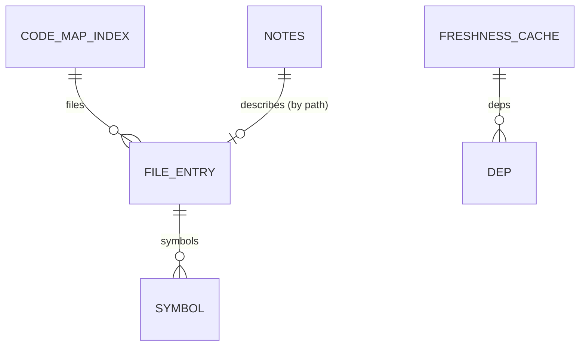

# SCHEMA - Database Schema

> No database. These are the files the kit persists; changing their format needs a version bump.

Status: Active - persisted files, no database

## Entities and relations

| Store | Location | Format | Committed |
|-------|----------|--------|-----------|
| Code map index | `<repo>/.claude/code-map/index.json` | `{version, files: {path: {hash, stamp, lines, kind, purpose, symbols[[kind,name,start,end,sig]], imports, deps, shape}}}` | no (gitignored) |
| Code map notes | `<repo>/.claude/code-map/notes.json` | `{path: {text, shape}}` | yes |
| Freshness cache | `$CLAUDE_PLUGIN_DATA/freshness-<hash>.json` | freshness_report --json payload | no |
| Vault | `<repo>/docs/vault/*.md` | markdown with `vault:auto` blocks | yes |

## Migration policy
Bump code_map.VERSION when the index format changes (old indexes are rebuilt automatically).

## Detected from code

<!-- vault:auto:start -->
<!-- generated by vault.py sync: do not edit by hand -->
### Entities (2; sources: SQL)
| Entity/table | Columns/fields | Defined at |
|---|---|---|
| operators | id integer, name text | scripts/selftest.py:705 |
| scans | id integer, result text | scripts/selftest.py:662 |
<!-- vault:auto:end -->
