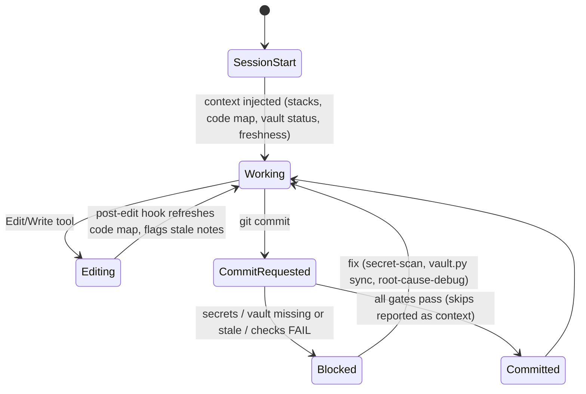

# STATE - State Machine

> The plugin's runtime life cycle: what the hooks do as a session moves through its states.

## State diagram

## States and transitions
| State | Entered when | Leaves when (event -> next state) | Allowed actions |
|-------|--------------|-----------------------------------|-----------------|
| SessionStart | Claude Code starts/clears | context printed -> Working | read-only detection, background builds |
| Working | context ready | Edit/Write -> Editing; git commit -> CommitRequested | any |
| Editing | file edited | hook done -> Working | code-map update only |
| CommitRequested | Bash command contains git commit | gate result -> Blocked/Committed | scans, vault check, verify |
| Blocked | a gate failed | user/agent fixes -> Working | fix, never bypass silently |
| Committed | gates passed | -> Working | |

## Detected from code

<!-- vault:auto:start -->
<!-- generated by vault.py sync: do not edit by hand -->
### State enums (2)
| Enum | States | Defined in |
|---|---|---|
| LinkStatus | connected, lost | scripts/selftest.py |
| RobotState | Idle, Moving, Error | scripts/selftest.py |
<!-- vault:auto:end -->
